# 아날로그 크로스바 MLP 실험 정리

> 디지털로 학습한 신경망을 저항 회로로 옮기면 얼마나 틀리고, 그 오차를 어떻게 줄일 수 있을까?

**한 줄 결론** — 보통 품질의 칩은 디지털과 같은 정확도(97.6%)를 낸다. 소자 편차가 30%로 커지면 86.5%까지 떨어지지만, 열별 보정으로 96.5%까지 회복된다.

- 시각화 사이트: [jeehoo0507.github.io/mul-li](https://jeehoo0507.github.io/mul-li/)
- 코드: [`sim/`](sim/) · 그림: [`figures/`](figures/)

---

## 0. 실험 개요

| 항목 | 내용 |
|---|---|
| 질문 | 행렬곱을 옴의 법칙(곱셈)과 키르히호프 전류 법칙(덧셈)만으로 계산하면, 회로의 물리적 한계 때문에 얼마나 틀리는가 |
| 방법 | MLP를 디지털로 학습 → 가중치를 저항(컨덕턴스)으로 변환 → 층마다 크로스바 회로에 배치 → 비이상성을 넣어 시뮬레이션 |
| 비교 | 디지털 / 아날로그(일반 학습) / 아날로그 + 하드웨어 인식 학습 / 아날로그 + 열별 보정 |
| 측정 | 설정마다 칩 10개(일부 40개)를 따로 만들어 정확도와 출력 오차를 평균 |

**핵심 결론**

1. **체계적 오차는 보정으로 잡힌다.** IR drop 출력 오차 22% → 2%, 소자 편차·단계 수 오차는 절반으로.
2. **무작위 오차는 보정으로 안 잡힌다.** ADC 양자화, 읽기 잡음, DAC 오차는 그대로. 정밀도는 하드웨어로만 살 수 있다.
3. **ADC는 5비트가 경계.** 5비트 이상이면 디지털과 같고, 3비트 이하에서 급격히 무너진다.

---

## 1. 데이터와 MLP 학습

회로 없이 디지털로 먼저 학습해서 정답 기준(97.6%)을 만들었다. 이 가중치를 그대로 회로로 옮기는 것이 이후 모든 실험의 출발점이다.

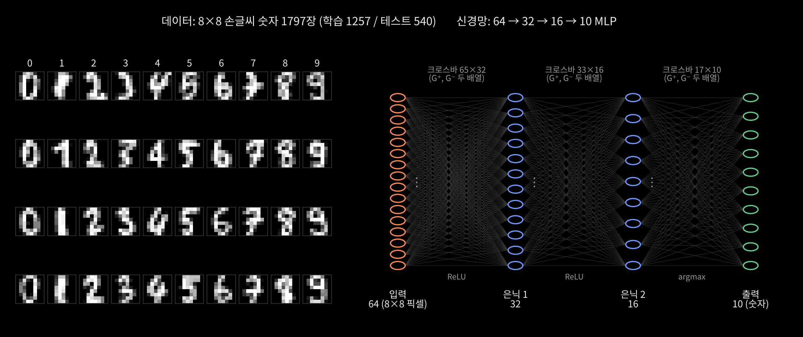

- **데이터**: scikit-learn 내장 8×8 손글씨 숫자 1797장 (학습 1257 / 테스트 540). 픽셀 0~16을 0~1로 정규화.
- **구조**: 64(픽셀) → 32 → 16 → 10(숫자), 은닉층 ReLU. 바이어스 때문에 회로에서는 입력이 하나씩 더 붙은 **65×32, 33×16, 17×10** 크로스바가 된다.
- **학습**: Adam(학습률 0.003), 배치 64, 300 에포치, 가중치 감쇠 1e-4. numpy로 직접 구현.
- **두 모델**: 일반 학습(97.6%)과, 매 배치마다 가중치에 15% 잡음을 넣은 하드웨어 인식 학습(97.8%).

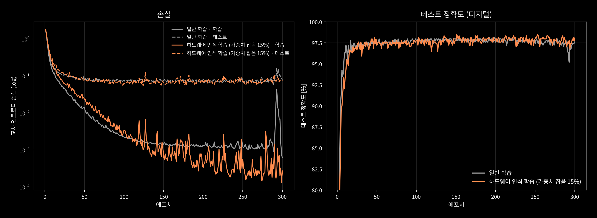

학습 손실은 계속 줄지만 테스트 손실은 약 50 에포치 이후 0.07 근처에서 평평하다. 약간의 과적합이 있지만 테스트 정확도는 97~98%에서 안정적이다.

---

## 2. 회로 설계 ① 가중치를 저항으로 옮기기

**핵심: 가중치 하나 = 저항 두 개(G⁺, G⁻)의 짝.**
저항(컨덕턴스)에는 음수가 없다. 그래서 양수 가중치는 G⁺에, 음수 가중치는 크기만 G⁻에 담고, 계산 끝에 G⁺ − G⁻로 빼서 부호를 되살린다. 배열이 모든 칸에 깔리므로 양수 가중치도 짝을 받아 (값, 0)으로 들어간다.

| 가중치 | G⁺ | G⁻ | G⁺ − G⁻ |
|---|---|---|---|
| +0.8 | 80 µS | 0 | +80 |
| −0.5 | 0 | 50 µS | −50 |
| 0 | 0 | 0 | 0 |

$$
G^{\pm}_{ij} = G_{min} + (G_{max} - G_{min}) \cdot \frac{\max(\pm w_{ij},\ 0)}{w_{max}}
$$

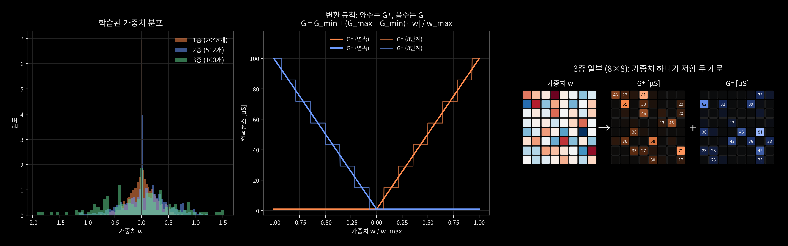

| 칸 | 무엇 | 핵심 |
|---|---|---|
| 왼쪽 | 바꿀 숫자들 (학습된 가중치 분포) | 대부분 0 근처. 가장 큰 \|w\|를 저항 최댓값 100 µS에 맞춘다 |
| 가운데 | 바꾸는 규칙 | 양수면 주황(G⁺)만, 음수면 파랑(G⁻)만 올라간다. 계단선은 소자가 8단계만 쓸 수 있을 때의 반올림 |
| 오른쪽 | 실제로 바꾼 결과 (3층 8×8 조각) | 빨간(양수) 칸 → G⁺에, 파란(음수) 칸 → G⁻에 값이 생긴다 |

- G_min(1 µS)은 소자를 완전히 끌 수 없어 남는 최솟값으로, G⁺와 G⁻에 똑같이 들어가 뺄셈에서 사라진다.
- **바이어스**: 입력이 항상 최대 전압(0.2 V)인 행을 하나 추가해서 처리한다.

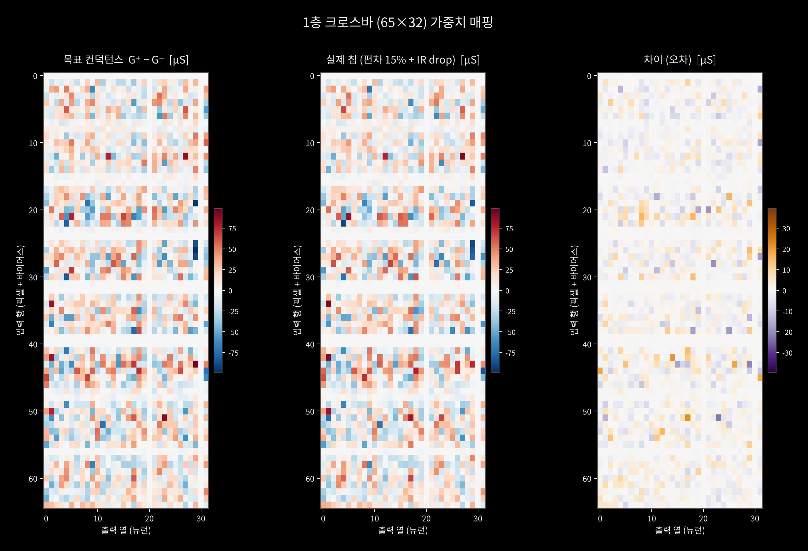

1층 65×32 전체를 칸마다 G⁺ − G⁻ 색으로 그렸다. 빨강 = 양수, 파랑 = 음수, 흰색 ≈ 0.

| 칸 | 무엇 | 비유 |
|---|---|---|
| 왼쪽 | 쓰려고 한 값 (목표) | 설계도 |
| 가운데 | 실제로 써진 값 (소자 편차 15% + IR drop) | 실제로 지은 건물 |
| 오른쪽 | 둘의 차이 (오차) | 어긋난 부분만 표시 |

**오차가 생기는 이유**

- **흩어진 진한 점 = 소자 편차 (무작위).** 소자가 원자 수백 개 수준으로 작아서, 제조할 때도 값을 쓸 때도 원자 배치가 확률적으로 정해진다. 같은 값을 써도 칸마다 다르게 써진다. 15%는 비율이라 큰 가중치일수록 오차도 크다.
- **옅은 치우침 = IR drop (규칙적).** 도선에도 저항이 있어 전원·읽기부에서 먼 칸일수록 걸리는 전압이 줄어든다(V = IR).
- 하얀 가로줄은 숫자 이미지 가장자리처럼 항상 0인 픽셀이라 가중치가 생기지 않은 자리다.

---

## 3. 회로 설계 ② 크로스바를 이루는 다섯 부품

계산은 전류로 하고, 읽기는 전압으로 한다.

| 부품 | 회로 | 하는 일 |
|---|---|---|
| **곱셈** | 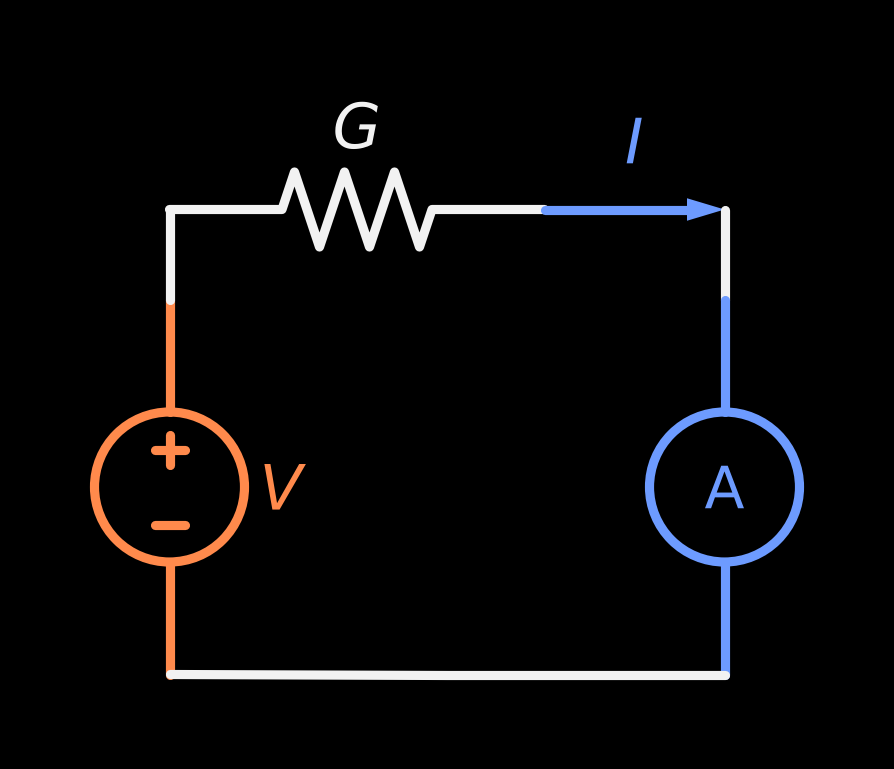 | 저항 하나 = 곱셈기. 입력 전압 V × 컨덕턴스 G = 전류 I (옴의 법칙) |
| **덧셈** | 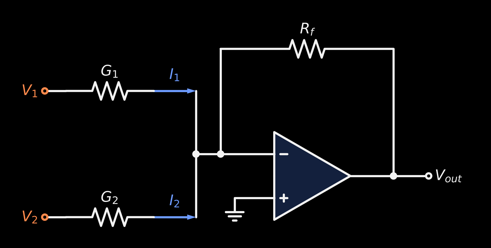 | 도선 합류 = 덧셈기. 한 점에 모인 전류는 저절로 더해진다 (키르히호프 전류 법칙) |
| **읽기 (TIA)** | 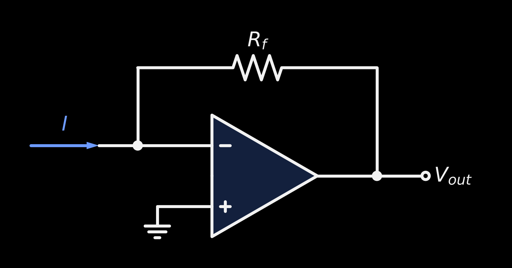 | op-amp가 열 끝을 0 V로 붙잡은 채 전류를 전압으로: V_out = −I·R_f |
| **뺄셈** | 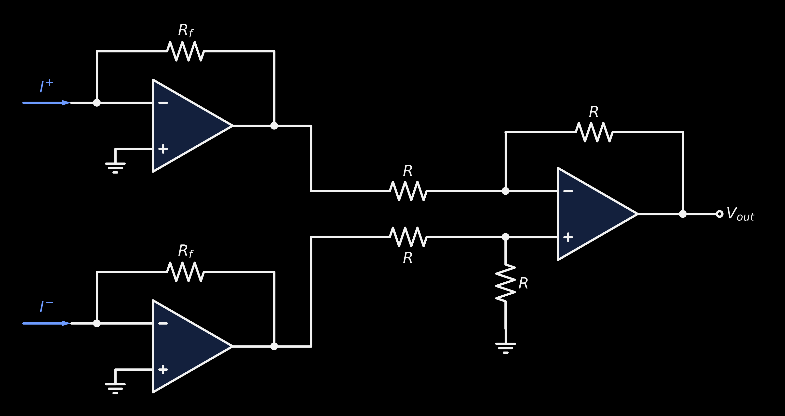 | G⁺ 열과 G⁻ 열을 각각 TIA로 읽고 차동 증폭기로 빼서 I⁺ − I⁻ |
| **크로스바** | 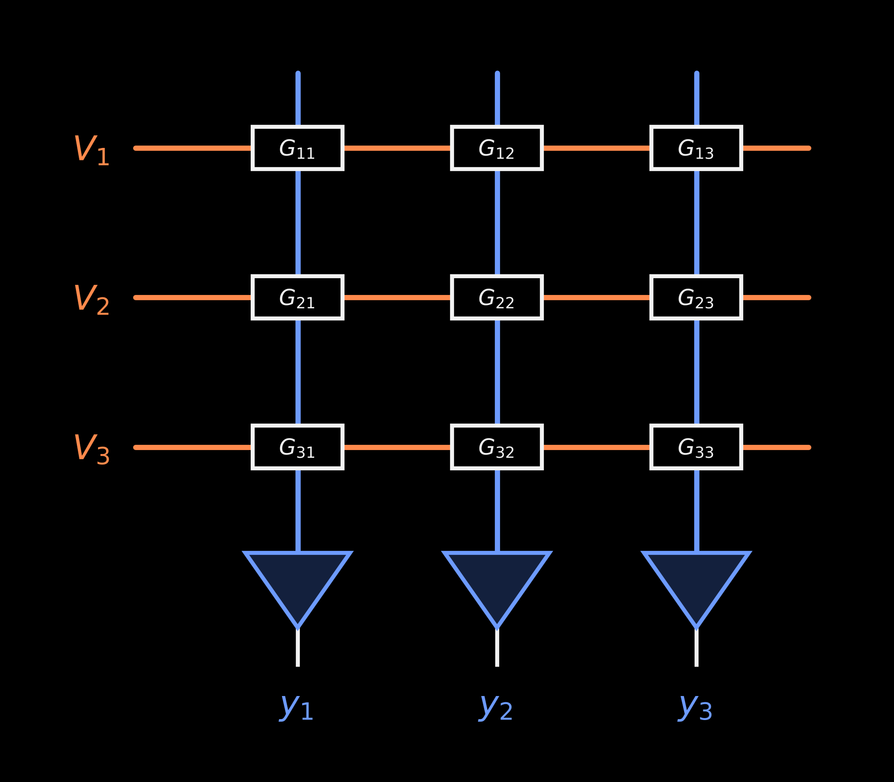 | 격자 하나로 행렬곱 전체가 한 번에. 열 j의 전류가 W·x의 j번째 값 |

$$
I_j = \sum_i G_{ij} V_i
$$

**왜 TIA인가** — 결과 전류를 작은 저항(감지 저항)에 흘려 바로 재면, 그 전압만큼 계산 노드가 0 V에서 떠서 각 저항에 걸리는 전압이 줄고 결과가 작게 나온다. TIA는 노드를 0 V로 유지한 채 전압 강하를 출력 쪽으로 옮겨서, 계산을 방해하지 않고 읽는다.

마지막으로 ADC가 TIA 출력 전압을 숫자로 바꾸고, ReLU는 디지털로 적용해 다음 층 DAC로 넘긴다.

---

## 4. 전체 회로와 한 숫자의 신호 흐름

세 층을 이으면 **저항 5,556개, TIA 116개, ADC 58개**짜리 칩이 된다.

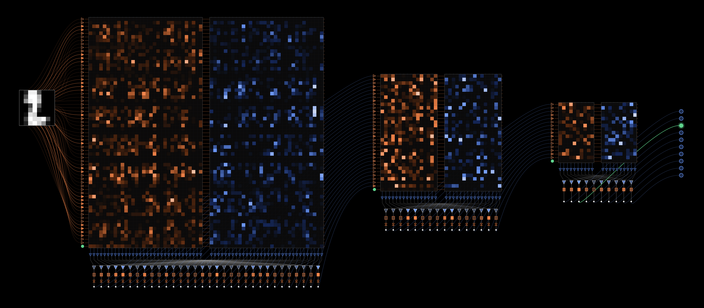

- **판 세 묶음** = 층 3개. 묶음마다 **왼쪽 주황 판 = G⁺ 배열, 오른쪽 파랑 판 = G⁻ 배열**.
- 1층은 저항이 4천 개가 넘어 칸이 색 덩어리처럼 보인다.
- 왼쪽 끝 숫자 → DAC(삼각형) → 크로스바 → TIA → 차동 증폭기 → ADC → ReLU → 다음 층 → 오른쪽 끝 출력 10개 중 초록이 답.

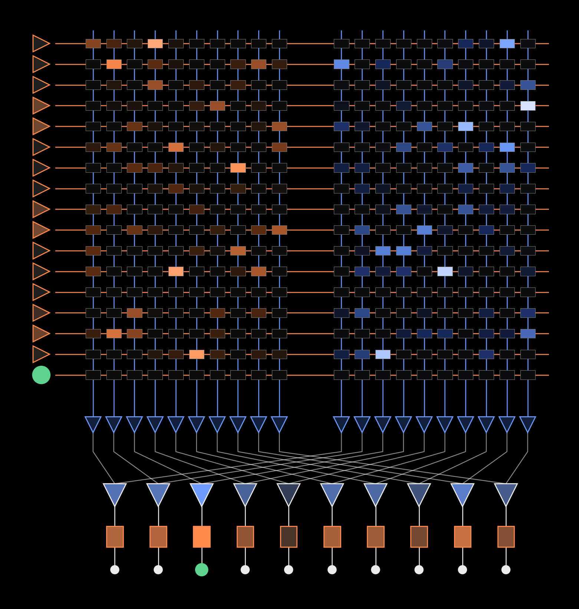

위 그림의 마지막 층만 확대했다. 위에서 아래로:

1. 왼쪽 삼각형 = **DAC** (진할수록 큰 전압), 맨 아래 초록 원 = 바이어스
2. 칸 하나 = **저항** 하나 (밝을수록 큰 컨덕턴스). 가운데 틈 기준 왼쪽 G⁺, 오른쪽 G⁻
3. 세로줄 = 전류가 모이는 길 (**덧셈**)
4. 작은 삼각형 20개 = 열마다 **TIA**
5. X자로 꼬인 선 = G⁺ 열과 G⁻ 열을 **짝지어** 연결
6. 큰 삼각형 10개 = **차동 증폭기** (뺄셈)
7. 사각형 = **ADC**
8. 맨 아래 점 10개 = 숫자 0~9, **초록 점이 답**

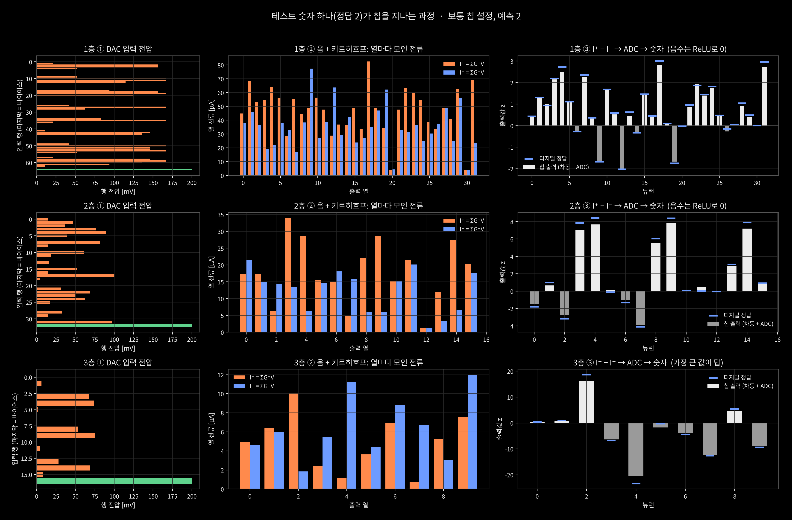

같은 숫자가 칩을 지나는 과정을 층마다 세 단계로 펼쳤다.

1. **DAC 입력 전압**: 이전 층 값을 0~200 mV로 바꾼 행 전압 (초록 = 바이어스)
2. **열 전류**: 옴 + 키르히호프로 모인 I⁺(주황)와 I⁻(파랑), 수~수십 µA
3. **출력**: I⁺ − I⁻를 ADC로 읽은 값(흰 막대) vs 디지털 정답(파란 눈금). 음수는 ReLU로 0, 마지막 층은 가장 큰 값이 답

---

## 5. 비이상성 모델

| 비이상성 | 원인 | 모델 | 보통 칩 | 열악한 칩 |
|---|---|---|---|---|
| 소자 단계 수 | 컨덕턴스를 연속적으로 못 씀 | G를 L단계로 반올림 | 32단계 | 8단계 |
| 소자 편차 | 제조·쓰기 편차 | G' = G(1 + ε), ε ~ N(0, σ²) | σ 5% | σ 15~30% |
| IR drop | 배선 저항 | 먼 셀일수록 전압 감소 (가장 먼 셀 β만큼) | β 5% | β 15% |
| 열잡음 | 전자의 열운동 | √(4kTB·ΣG), 300 K, 100 MHz | 켬 | 켬 |
| 읽기 잡음 | 회로 잡음 | ADC 풀스케일의 일정 비율 | 0.2% | 2% |
| DAC | 입력 정밀도 | 0~0.2 V를 b비트로 | 8비트 | 4비트 |
| ADC | 출력 정밀도 | ±풀스케일을 b비트로 (넘으면 잘림) | 8비트 | 4비트 |

비이상성을 모두 끄면 칩 출력이 디지털과 10⁻¹⁴ 이내로 같다. 회로 모델 자체에는 오류가 없다.

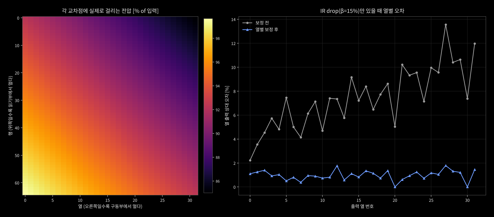

왼쪽: IR drop 15%일 때 각 교차점에 실제로 걸리는 전압. 오른쪽 위로 갈수록 86%까지 떨어진다.
오른쪽: 그 결과 먼 열일수록 출력 오차가 커지지만(최대 약 13%), 열별 보정 후 2% 안쪽으로 줄어든다.

---

## 6. 결과: 무엇이 얼마나 틀리게 만드나

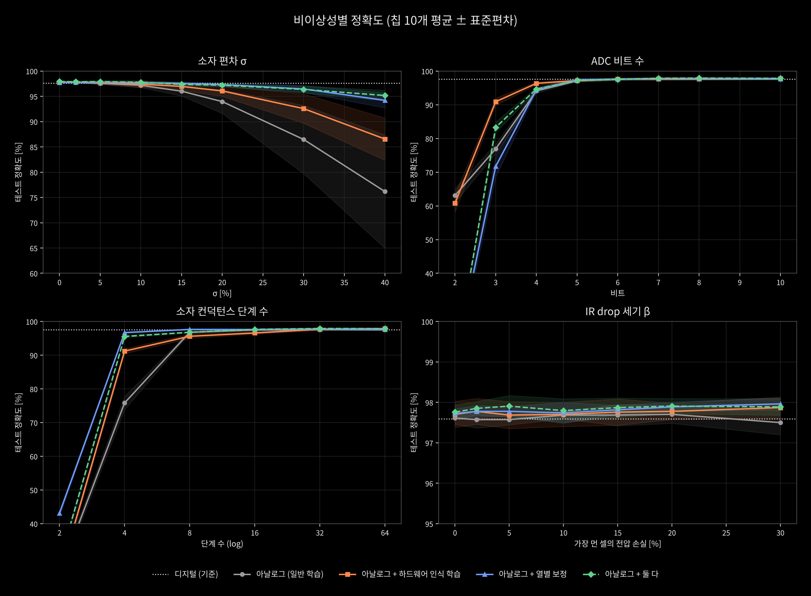

다른 값은 보통 칩으로 고정하고 하나만 바꿨다 (점선 = 디지털 97.6%).

| 바꾼 것 | 버티는 구간 | 무너지는 지점 |
|---|---|---|
| 소자 편차 σ | ~10% | 20% → 94.0%, 30% → 86.5%, 40% → 76.2% |
| ADC 비트 | 5비트 이상 | 4비트 94.1%, 3비트 76.9%, 2비트 63.1% |
| 소자 단계 | 8단계 이상 (96.8%) | 4단계 75.8%, 2단계 24.9% |
| IR drop | 30%까지 거의 그대로 | — (출력값은 틀어져도 순위가 유지됨) |

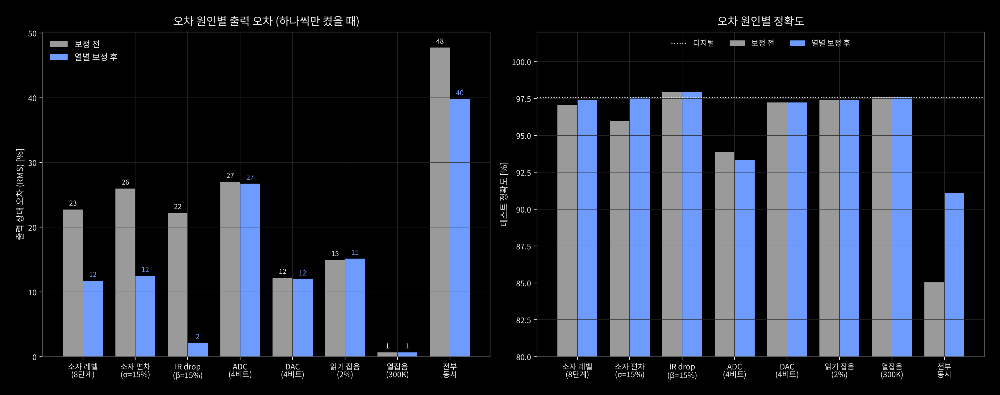

비이상성을 하나씩만 강하게 켰을 때:

| 원인 | 출력 오차 (보정 전 → 후) | 정확도 (보정 전 → 후) | 종류 |
|---|---|---|---|
| IR drop β 15% | 22% → **2%** | 98.0% → 98.0% | 체계적 |
| 소자 편차 σ 15% | 26% → **12%** | 96.0% → 97.6% | 칩마다 고정 |
| 소자 8단계 | 23% → **12%** | 97.0% → 97.4% | 칩마다 고정 |
| ADC 4비트 | 27% → 27% | 93.9% → 93.3% | 무작위 |
| 읽기 잡음 2% | 15% → 15% | 97.4% → 97.4% | 무작위 |
| DAC 4비트 | 12% → 12% | 97.2% → 97.2% | 무작위 |
| 열잡음 300 K | 0.7% → 0.7% | 97.6% → 97.6% | 무작위 (무시 가능) |
| 전부 동시 | 48% → 40% | 85.0% → **91.1%** | |

열잡음이 거의 0인 이유: 신호 전류는 µA, 열잡음은 nA 단위라 묻힌다. 이 규모에서는 열역학적 한계보다 소자와 변환기의 한계가 먼저 온다.

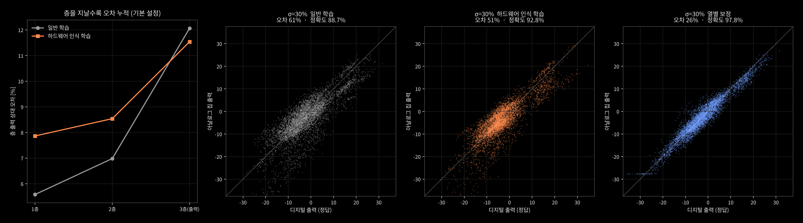

- **왼쪽**: 보통 칩에서도 1층 5.6% → 2층 7.0% → 출력층 12.1%로 오차가 쌓인다.
- **오른쪽 세 개 (σ = 30%)**: 대각선에 가까울수록 정확. 일반 학습(오차 61%, 88.7%) → 하드웨어 인식(51%, 92.8%) → 열별 보정(26%, 97.8%).

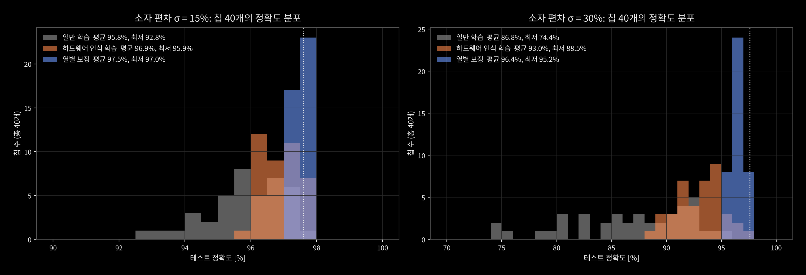

같은 설정이라도 칩마다 결과가 다르다. σ = 30%에서 일반 학습은 칩에 따라 74.4%~95.6%로 크게 흔들리지만, 열별 보정을 하면 모든 칩이 95.2% 이상에 모인다. 실제 생산에서는 평균보다 이 **최저값**이 수율을 결정한다.

---

## 7. 오차 보정: 학습으로 버티기 vs 측정해서 되돌리기

σ = 30%에서 **일반 86.5% → 하드웨어 인식 학습 92.6% → 열별 보정 96.5%** (칩 10개 평균).

| | 하드웨어 인식 학습 | 열별 보정 |
|---|---|---|
| 하는 일 | 학습할 때 가중치에 15% 잡음을 넣어 오차에 둔감한 가중치를 찾음 | 보정용 숫자 200장을 흘려 열마다 이득·오프셋을 측정하고 디지털로 되돌림 |
| 언제 | 칩 만들기 전 (모든 칩에 같은 모델) | 칩 만든 뒤 (칩마다 따로) |
| 비용 | 학습 한 번 | 칩마다 측정 한 번 + 열마다 곱셈·덧셈 하나 |
| 잘 잡는 것 | 소자 편차, 저정밀 ADC (3~4비트) | 칩마다 고정된 오차: IR drop, 소자 편차, 단계 수 |
| 못 잡는 것 | 단계 수 8~16에서는 오히려 약간 나빠짐 | 매번 달라지는 무작위 오차. ADC 3비트 이하에선 보정 자체가 망가짐 (2비트 13.6%) |

**핵심은 오차의 종류다.** 칩마다 고정된 오차는 한 번 재면 되돌릴 수 있지만, 읽을 때마다 달라지는 오차는 재도 다음 번엔 또 다르다.

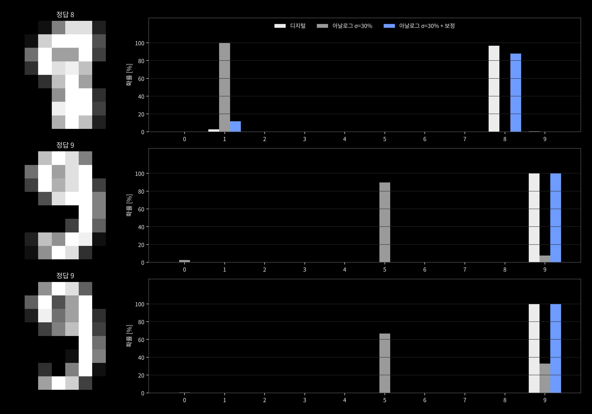

σ = 30% 칩이 틀렸다가 보정 후 맞힌 숫자들. 8을 1로, 9를 5로 확신하던 칩이 저항을 다시 쓰지 않고 열마다 숫자 두 개(이득, 오프셋)만 고쳐서 디지털과 같은 답을 낸다.

---

## 8. 결론과 한계

**결론**

1. 학습된 가중치를 G⁺/G⁻ 저항 쌍으로 옮긴 크로스바는 보통 품질에서 디지털과 같은 97.6%를 낸다.
2. 소자 편차(σ ≥ 20%), 소자 단계(≤ 4단계), ADC(≤ 4비트)가 정확도를 무너뜨리는 주범이다.
3. 체계적 오차는 보정으로 대부분 되돌릴 수 있지만, 무작위 오차는 줄지 않는다. 정밀도 1비트당 최소 전력이 4배 드는 P_min = 4kTB·4ᵇ와 같은 방향의 결론이다.
4. 오차는 층마다 쌓이므로(5.6% → 12.1%), 큰 모델일수록 보정이 더 중요하다.

**한계**

- IR drop은 저항망 전체를 푼 것이 아니라 거리 비례 근사다.
- ReLU와 보정은 디지털로 처리했다. 실제 칩에서는 그 변환 비용이 추가된다.
- 소자 드리프트, 온도 변화, 쓰기 수명, 읽기 교란은 넣지 않았다.
- 8×8 숫자와 작은 MLP라서, 큰 모델의 오차 누적은 더 심할 수 있다.
- 에너지와 속도는 다루지 않았다. 정확도와 오차만 측정했다.

**재현**

```bash
pip install numpy scikit-learn matplotlib
python sim/sim.py          # 학습 + 실험
python sim/figs.py         # 회로도, 정확도·오차 그림
python sim/extra_figs.py   # 데이터·학습 곡선·변환·신호 흐름·칩별 편차
python tools/build_site.py # 시각화 사이트 다시 생성
```
